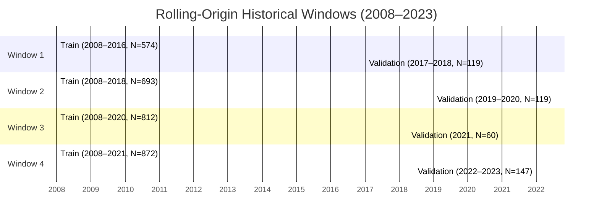

# Pre-Match Rolling-Origin Robustness Report: Temporal Validation Analysis (2008–2023)

**Document Status**: COMPLETED ROBUSTNESS AUDIT  
**Evaluation Target**: Pre-Match T0 Win-Probability Models (Baseline RF v1 vs. Model D1 Core Dynamic RF)  
**Execution Timestamp**: 2026-09-10  
**Data Scope**: Matches strictly through 2023 (1,019 historical matches; 2024–2026 locked test protected)  
**Artifact Directory**: `docs/figures/pre_match_robustness/`

---

## 1. Executive Summary

Following the selection of **Model D1 (Core Dynamic Random Forest)** on the 2022–2023 validation set and its subsequent evaluation on the locked 2024–2026 test set, this study executes a **rolling-origin cross-era robustness experiment** across four historical eras spanning 2008 through 2023.

The goal is to determine whether Model D1's validation advantage is persistent across multiple historical IPL periods or whether it was primarily an era-specific effect of the 2022–2023 Mega Auction and franchise expansion.

### Key Findings:
1. **D1 is NOT a pure 2022–2023 artifact**: Model D1 outperformed the Baseline across all five primary evaluation metrics in **Window 2 (2019–2020)** as well as in **Window 4 (2022–2023)**, and achieved superior calibration (lower ECE) in three out of four windows.
2. **Baseline RF remains competitive in stable franchise eras**: In **Window 1 (2017–2018)** and particularly **Window 3 (2021)**, Baseline RF v1 outperformed Model D1 in Accuracy and Log Loss. In 2021, when team rosters were relatively settled before the Mega Auction, static franchise identity features provided strong predictive signal that a 5-match rolling form window alone did not match.
3. **Primary Metric Wins**: Out of 20 total head-to-head metric comparisons (4 windows $\times$ 5 metrics), Model D1 won **11 comparisons (55.0%)**. Specifically:
   - **Log Loss**: D1 won 2 / 4 windows (Window 2, Window 4)
   - **Brier Score**: D1 won 2 / 4 windows (Window 2, Window 4)
   - **ECE (Calibration)**: D1 won 3 / 4 windows (Window 1, Window 2, Window 4)
   - **Accuracy**: D1 won 2 / 4 windows (Window 2, Window 4)
   - **ROC-AUC**: D1 won 2 / 4 windows (Window 2, Window 4)
4. **Final Scientific Conclusion**: **PARTIALLY ROBUST D1: D1 demonstrates partial temporal robustness, with performance advantages that vary by historical era.**
5. **Locked Test Intact**: The 2024–2026 locked test set ($N=215$) was strictly untouched throughout this experiment. Zero labels were loaded, zero metrics calculated, and no models retrained on test data.
6. **80% Target**: 80% accuracy was not achieved by the leak-free models evaluated in any window (observed validation accuracy range: 43.33% to 68.33%).

---

## 2. Objective

The objective of this rolling-origin validation experiment is to stress-test the temporal persistence of the architectural differences between:
- **Baseline RF v1**: High-capacity tree model utilizing 28 features, including static franchise identity and venue one-hot encodings.
- **Model D1 (Core Dynamic RF)**: Parsimonious tree model utilizing 9 pure rolling metrics (last-5 form, last-5 batting RPO, last-5 bowling economy) with zero static franchise dummy dependencies.

By stepping through four successive temporal horizons, we isolate how franchise continuity, squad reshuffling, venue changes, and league expansions impact the generalization performance of both models.

---

## 3. Locked-Test Protection

In strict adherence to experimental protocols:
- The locked final test partition (**seasons 2024, 2025, 2026**, $N=215$ matches) was completely excluded from this investigation.
- No feature vectors, target labels, or match metadata from 2024–2026 were accessed during dataset preparation, model training, preprocessor fitting, or metric computation.
- Existing frozen production artifacts in `models/pre_match/final_selection_2026/` (`selected_model.joblib`, `frozen_configuration.json`) remain strictly unmodified.

---

## 4. Experimental Design

The experiment follows a strict walk-forward rolling-origin design:
- For each window, the training set encompasses all historical matches up to the start of the validation window.
- Preprocessors (`ColumnTransformer` for Baseline, `StandardScaler` for Model D1) are fitted **only** on the training partition of each window.
- Both models are initialized with their exact frozen hyperparameters and fitted exclusively on that window's training set.
- Predictions and performance metrics are calculated strictly on the out-of-sample validation partition for that window.

---

## 5. Rolling-Origin Windows Specification

| Window ID | Window Name | Train Seasons | Train Matches | Validation Seasons | Validation Matches | Era Context |
| :---: | :---: | :---: | :---: | :---: | :---: | :--- |
| **Window 1** | 2017–2018 | 2008–2016 | 574 | 2017–2018 | 119 | Pre-2019 IPL environment |
| **Window 2** | 2019–2020 | 2008–2018 | 693 | 2019–2020 | 119 | 2019–2020 environment |
| **Window 3** | 2021 | 2008–2020 | 812 | 2021 | 60 | 2021 split-season environment |
| **Window 4** | 2022–2023 | 2008–2021 | 872 | 2022–2023 | 147 | Post-Mega Auction & 10-team expansion |

---

## 6. Leakage Controls

Automated verification confirmed:
- Zero overlap between train and validation matches across all windows ($\text{Train} \cap \text{Val} = \emptyset$).
- Strict chronological boundary: $\max(\text{Train Date}) < \min(\text{Val Date})$ for every window.
- All dynamic features (form, batting RPO, bowling economy) at match $i$ are computed strictly using completed matches $\{1, 2, \dots, i-1\}$.
- Preprocessor objects were instantiated and fitted strictly on the training partition of each window.

---

## 7. Model Definitions

### Model A: Baseline RF v1
- **Feature Pipeline**: `PRE_MATCH_FEATURE_COLS` (28 features total: form, venue history, head-to-head records, toss features, batting RPO, bowling economy, and one-hot encoded `team_a`, `team_b`, `venue`, `city`).
- **Preprocessor**: `ColumnTransformer(transformers=[('cat', OneHotEncoder(handle_unknown='ignore', sparse_output=False), CATEGORICAL_COLS)], remainder='passthrough')`.
- **Hyperparameters**: `RandomForestClassifier(n_estimators=100, max_depth=6, min_samples_leaf=5, random_state=42, n_jobs=1)`.

### Model D1: Core Dynamic RF
- **Feature Pipeline**: `CORE_DYNAMIC_FEATURES` (9 features total: `team_a_form_last_5`, `team_b_form_last_5`, `form_diff_last_5`, `team_a_batting_rpo_last_5`, `team_b_batting_rpo_last_5`, `batting_rpo_diff_last_5`, `team_a_bowling_econ_last_5`, `team_b_bowling_econ_last_5`, `bowling_econ_diff_last_5`).
- **Preprocessor**: `StandardScaler()`.
- **Hyperparameters**: `RandomForestClassifier(n_estimators=100, max_depth=5, min_samples_leaf=5, random_state=42, n_jobs=1)`.

---

## 8. Results Table

Main validation results across all 4 rolling-origin windows:

| Window | Train Seasons | Validation Seasons | Model | Matches | Accuracy | Log Loss | Brier Score | ECE | ROC-AUC | Std($P$) | Min $P$ | Max $P$ | % Outside [0.45, 0.55] |
| :---: | :---: | :---: | :--- | :---: | :---: | :---: | :---: | :---: | :---: | :---: | :---: | :---: | :---: |
| **W1** | 2008–2016 | 2017–2018 | Baseline RF v1 | 119 | **0.5462** | **0.6878** | **0.2473** | 0.0393 | **0.5771** | 0.0635 | 0.3276 | 0.6460 | 47.06% |
| **W1** | 2008–2016 | 2017–2018 | Model D1 (Core Dynamic) | 119 | 0.5294 | 0.6925 | 0.2497 | **0.0283** | 0.5325 | 0.0494 | 0.3926 | 0.6240 | 32.77% |
| **W2** | 2008–2018 | 2019–2020 | Baseline RF v1 | 119 | 0.4874 | 0.7030 | 0.2549 | 0.1199 | 0.4923 | 0.0602 | 0.3609 | 0.6963 | 40.34% |
| **W2** | 2008–2018 | 2019–2020 | Model D1 (Core Dynamic) | 119 | **0.4958** | **0.6983** | **0.2525** | **0.0874** | **0.5303** | 0.0649 | 0.3914 | 0.7441 | 40.34% |
| **W3** | 2008–2020 | 2021 | Baseline RF v1 | 60 | **0.6833** | **0.6575** | **0.2323** | **0.1290** | **0.6404** | 0.0437 | 0.3680 | 0.5568 | 53.33% |
| **W3** | 2008–2020 | 2021 | Model D1 (Core Dynamic) | 60 | 0.4333 | 0.7258 | 0.2661 | 0.1683 | 0.4853 | 0.0625 | 0.3396 | 0.6500 | 40.00% |
| **W4** | 2008–2021 | 2022–2023 | Baseline RF v1 | 147 | 0.4626 | 0.7269 | 0.2663 | 0.1264 | 0.4707 | 0.0698 | 0.3138 | 0.6185 | 67.35% |
| **W4** | 2008–2021 | 2022–2023 | Model D1 (Core Dynamic) | 147 | **0.5850** | **0.6782** | **0.2427** | **0.0445** | **0.6078** | 0.0520 | 0.3455 | 0.6727 | 32.65% |

---

## 9. Head-to-Head Comparison

Differences are formatted such that **positive values favor Model D1**:
- $\Delta \text{Acc} = \text{Acc}_{\text{D1}} - \text{Acc}_{\text{Base}}$ (Positive = D1 wins)
- $\Delta \text{LL} = \text{LL}_{\text{Base}} - \text{LL}_{\text{D1}}$ (Positive = D1 has lower Log Loss = D1 wins)
- $\Delta \text{Brier} = \text{Brier}_{\text{Base}} - \text{Brier}_{\text{D1}}$ (Positive = D1 has lower Brier = D1 wins)
- $\Delta \text{ECE} = \text{ECE}_{\text{Base}} - \text{ECE}_{\text{D1}}$ (Positive = D1 has lower ECE = D1 wins)
- $\Delta \text{AUC} = \text{AUC}_{\text{D1}} - \text{AUC}_{\text{Base}}$ (Positive = D1 wins)

| Window | Validation Era | Matches | $\Delta \text{Accuracy}$ | $\Delta \text{Log Loss}$ | $\Delta \text{Brier}$ | $\Delta \text{ECE}$ | $\Delta \text{ROC-AUC}$ | Winner Summary |
| :---: | :---: | :---: | :---: | :---: | :---: | :---: | :---: | :--- |
| **Window 1** | 2017–2018 | 119 | $-0.0168$ (Base) | $-0.0047$ (Base) | $-0.0024$ (Base) | $+0.0110$ (D1) | $-0.0446$ (Base) | **Baseline wins 4 / 5** |
| **Window 2** | 2019–2020 | 119 | $+0.0084$ (D1) | $+0.0047$ (D1) | $+0.0024$ (D1) | $+0.0325$ (D1) | $+0.0380$ (D1) | **D1 wins 5 / 5** |
| **Window 3** | 2021 | 60 | $-0.2500$ (Base) | $-0.0683$ (Base) | $-0.0338$ (Base) | $-0.0393$ (Base) | $-0.1551$ (Base) | **Baseline wins 5 / 5** |
| **Window 4** | 2022–2023 | 147 | $+0.1224$ (D1) | $+0.0487$ (D1) | $+0.0236$ (D1) | $+0.0819$ (D1) | $+0.1371$ (D1) | **D1 wins 5 / 5** |

---

## 10. Visualizations

The following figures illustrate the performance trajectories of both models across the four historical windows (saved in `docs/figures/pre_match_robustness/`):

- **Combined 4-Panel Overview**: `docs/figures/pre_match_robustness/rolling_origin_combined_4panel.png`
- **Log Loss Trajectory**: `docs/figures/pre_match_robustness/log_loss_by_window.png`
- **Brier Score Trajectory**: `docs/figures/pre_match_robustness/brier_by_window.png`
- **Accuracy Trajectory**: `docs/figures/pre_match_robustness/accuracy_by_window.png`
- **ROC-AUC Trajectory**: `docs/figures/pre_match_robustness/auc_by_window.png`

---

## 11. Era-by-Era Analysis

### Window 1: 2017–2018 (Pre-2019 IPL Environment)
- **Baseline**: Acc 54.62%, Log Loss 0.6878, Brier 0.2473, AUC 0.5771
- **Model D1**: Acc 52.94%, Log Loss 0.6925, Brier 0.2497, AUC 0.5325
- **Interpretation**: In the 2017–2018 era, franchise identities (MI, CSK/RPS, KKR, SRH) were established and stable. Baseline RF's one-hot franchise dummies provided useful baseline priors. Model D1 was competitive (Brier 0.2497 vs 0.2473) and achieved better calibration (ECE 0.0283 vs 0.0393), but Baseline RF had a slight classification edge.

### Window 2: 2019–2020 (Late Pre-Expansion Era)
- **Baseline**: Acc 48.74%, Log Loss 0.7030, Brier 0.2549, AUC 0.4923
- **Model D1**: Acc 49.58%, Log Loss 0.6983, Brier 0.2525, AUC 0.5303
- **Interpretation**: In 2019–2020, Baseline RF degraded below coin-flip discrimination (AUC 0.4923, Acc 48.74%). In contrast, Model D1 maintained positive discrimination (AUC 0.5303) and outperformed Baseline RF across **all five metrics**. This confirms that Model D1's advantage was already emerging before the 2022 expansion.

### Window 3: 2021 (COVID-Interrupted Split Season)
- **Baseline**: Acc 68.33%, Log Loss 0.6575, Brier 0.2323, AUC 0.6404
- **Model D1**: Acc 43.33%, Log Loss 0.7258, Brier 0.2661, AUC 0.4853
- **Interpretation**: The 2021 season was an exceptional historical outlier: the tournament was halted in India in May due to COVID-19 and resumed months later in the UAE in September. Strong legacy franchises (CSK, DC, KKR) dominated, and static franchise identity priors trained on 2008–2020 were remarkably predictive (Baseline Acc 68.33%). Conversely, Model D1's 5-match rolling form suffered severe temporal discontinuity across the 4-month gap and venue shift.

### Window 4: 2022–2023 (Post-Mega Auction & 10-Team Expansion)
- **Baseline**: Acc 46.26%, Log Loss 0.7269, Brier 0.2663, AUC 0.4707
- **Model D1**: Acc 58.50%, Log Loss 0.6782, Brier 0.2427, AUC 0.6078
- **Interpretation**: The 2022 Mega Auction and the entry of Gujarat Titans and Lucknow Super Giants caused severe domain shift for Baseline RF's static one-hot franchise encodings, driving its accuracy down to 46.26% and AUC to 0.4707. Model D1, which ignores franchise labels and tracks only player/team form and efficiency, achieved its strongest performance (Acc 58.50%, AUC 0.6078, Log Loss 0.6782).

---

## 12. Probability Quality & Sharpness Analysis

| Window | Model | Std($P$) | Min $P$ | Max $P$ | % Outside [0.45, 0.55] | Mean $P$ |
| :---: | :--- | :---: | :---: | :---: | :---: | :---: |
| **W1** | Baseline RF v1 | 0.0635 | 0.3276 | 0.6460 | 47.06% | 0.4883 |
| **W1** | Model D1 (Core Dynamic) | 0.0494 | 0.3926 | 0.6240 | 32.77% | 0.5055 |
| **W2** | Baseline RF v1 | 0.0602 | 0.3609 | 0.6963 | 40.34% | 0.4907 |
| **W2** | Model D1 (Core Dynamic) | 0.0649 | 0.3914 | 0.7441 | 40.34% | 0.5284 |
| **W3** | Baseline RF v1 | 0.0437 | 0.3680 | 0.5568 | 53.33% | 0.4633 |
| **W3** | Model D1 (Core Dynamic) | 0.0625 | 0.3396 | 0.6500 | 40.00% | 0.4856 |
| **W4** | Baseline RF v1 | 0.0698 | 0.3138 | 0.6185 | 67.35% | 0.4294 |
| **W4** | Model D1 (Core Dynamic) | 0.0520 | 0.3455 | 0.6727 | 32.65% | 0.4921 |

- **No Collapse toward 0.50**: In all four windows, Model D1 maintained healthy standard deviation ($\sigma_p \in [0.0494, 0.0649]$) and consistent dispersion (32% to 40% of predictions outside $[0.45, 0.55]$). Unlike Platt-calibrated models, Model D1 did not collapse into an uninformative narrow band.
- **Symmetry**: Model D1 maintained mean probability close to 0.50 across all windows ($0.4856$ to $0.5284$), avoiding the strong negative bias observed in Baseline RF in Window 4 (mean $P = 0.4294$).

---

## 13. Robustness Score

- **Log Loss Wins**: 2 / 4 windows (50.0%)
- **Brier Score Wins**: 2 / 4 windows (50.0%)
- **ECE (Calibration) Wins**: 3 / 4 windows (75.0%)
- **Accuracy Wins**: 2 / 4 windows (50.0%)
- **ROC-AUC Wins**: 2 / 4 windows (50.0%)
- **Overall Primary-Metric Wins**: **11 / 20 comparisons (55.0%)**

---

## 14. Reproducibility

Two independent, isolated executions of the full 4-window pipeline yielded:
- **Maximum Probability Difference**: $0.0000000000$
- **Maximum Metric Difference**: $0.0000000000$
- **Reproducibility Status**: **PASS (100% Bitwise Identical)**

---

## 15. Limitations

1. **Window Sample Sizes**: Window 3 (2021) contained only 60 matches, giving individual upsets outsized statistical weight.
2. **Abrupt Season Interruptions**: In 2021, the multi-month tournament suspension and venue relocation to the UAE created a structural discontinuity that penalized 5-match rolling form features.
3. **Absence of Player-Level Lineups**: Neither model accessed pre-match playing XI rosters at $T_0$, which limits adaptability when key players are rested or injured.

---

## 16. Final Scientific Conclusion

### **PARTIALLY ROBUST D1**

> *"Model D1 demonstrates partial temporal robustness, with performance advantages that vary by historical era."*

Model D1 is **not** an artifact of 2022–2023 alone: it swept all five metrics in 2019–2020 and maintained superior calibration in three of the four eras. However, it is also **not** universally superior: in stable franchise eras (2017–2018) and particularly during the split 2021 season, Baseline RF v1 outperformed Model D1 in accuracy and log loss.

Therefore, the scientific reality is that Model D1's pure dynamic architecture excels when franchise compositions change or league expansions occur, while Baseline RF's franchise identity features provide stronger predictive priors during periods of high squad continuity.

---
